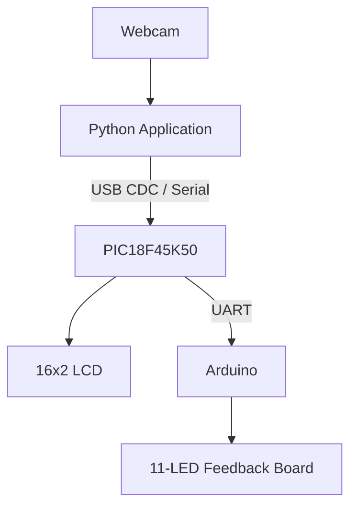

# Real-Time Computer Vision Rehabilitation System

A real-time posture assessment prototype integrating computer vision, embedded firmware, and hardware-based feedback.

## Overview

This project explores how computer vision and embedded systems can work together to provide real-time feedback during rehabilitation exercises. A webcam captures the user's movement, a Python application evaluates selected body landmarks and angles, and microcontrollers communicate posture-related status to an LCD and an 11-LED feedback board.

The project was developed as a university engineering prototype with input from an orthopedic physician.

**This is an educational prototype, not a certified medical device or a substitute for professional clinical assessment.**

## System Architecture

The system consists of three main components:

1. **Python application:** Processes webcam frames, detects body landmarks, evaluates predefined posture conditions, and transmits status data through USB serial communication.
2. **PIC18F45K50:** Receives data through USB CDC, displays status messages on a 16x2 LCD, and generates LED control commands through UART.
3. **Arduino:** Receives UART commands from the PIC and controls 11 LEDs according to the transmitted state pattern.



## Repository Structure

```text
computer-vision-rehab-system/
├── README.md
├── .gitignore
├── requirements.txt
├── python/
│   └── pose_detection.py
├── pic/
│   └── main.c
├── arduino/
│   └── led_controller.ino
└── docs/
    ├── architecture.md
    ├── hardware-and-wiring.md
```

The `docs/` directory contains additional architecture and hardware documentation. The complete MPLAB X project configuration and supporting Microchip USB CDC framework files are not included in this repository.

## Demo

The following video demonstrates the real-time computer vision application and its integration with the embedded feedback hardware.

The demonstration includes webcam-based posture assessment, on-screen feedback, LCD status messages, and the Arduino-controlled LED board.

**[Watch the project demonstration on YouTube](https://youtube.com/shorts/BwNQ4mhxnQw?feature=share)**


## Python Application

### Overview

The Python application is the computer vision component of the system. It processes live webcam frames, detects body landmarks using MediaPipe Pose, calculates selected angles, evaluates predefined posture conditions, and provides visual feedback.

When the detected status changes, the application transmits a serial message to the PIC microcontroller.

### Technologies

- Python
- OpenCV
- MediaPipe Pose
- NumPy
- pySerial

### Main Features

- Real-time webcam frame processing.
- Body landmark detection using MediaPipe Pose.
- Angle calculations using selected landmarks, including the ear, shoulder, hip, and elbow.
- Rule-based posture classification using predefined angle thresholds.
- On-screen feedback using OpenCV.
- Serial communication with the PIC at 9600 baud.
- Change-based status transmission to avoid sending repeated messages when the evaluated state has not changed.

### Setup

Python 3 and a compatible environment for the listed dependencies are required.

Install the dependencies from the repository root:

```bash
python -m pip install -r requirements.txt
```

Before running the application, check the serial port configured in `python/pose_detection.py`. The current demo configuration uses `COM7`; replace it with the port assigned to your PIC on your computer.

Run the application:

```bash
python python/pose_detection.py
```

Press `q` in the application window to exit.

### Posture Evaluation

The application uses selected body landmarks to calculate angles and compare them against predefined thresholds. The resulting posture states are used to generate feedback and a serial status message.

The thresholds and classifications represent the logic implemented in this prototype. They have not been established as clinically validated measurements.

## PIC18F45K50 Firmware — MPLAB X

### Overview

The PIC18F45K50 acts as the communication bridge between the Python application and the Arduino LED controller. Its firmware is written in C and uses the Microchip USB CDC framework.

### Responsibilities

- Receive data from the Python application through USB CDC.
- Display posture-related status messages on a 16x2 LCD.
- Interpret selected fields from the received data.
- Generate a command containing 11 LED state characters.
- Transmit LED commands to the Arduino using UART.
- Service USB CDC communication through the Microchip framework.

### Communication Configuration

| Interface | Configuration | Purpose |
|---|---|---|
| USB CDC | 9600 baud configured in the application | Python-to-PIC communication |
| UART | 9600 baud | PIC-to-Arduino communication |
| LCD | 16x2 character display | Visual status feedback |

### Build Requirements

The provided `pic/main.c` file documents the main firmware logic. Building the firmware requires a compatible MPLAB X project, the appropriate XC8 compiler, the correct PIC18F45K50 device configuration, and the required Microchip USB CDC framework files.

The complete MPLAB X project and supporting dependencies are not included in this repository. Refer to Microchip's official documentation and example projects for the USB CDC framework.

**Implementation note:** The current firmware reads selected characters from the USB receive buffer at fixed indices. USB CDC data may arrive in partial chunks, so message parsing and buffer handling should be verified when reproducing the demonstration.

## Arduino LED Controller

### Overview

The Arduino receives LED control commands from the PIC over a software-based serial connection and updates an 11-LED feedback board.

### Main Features

- Configures 11 digital pins as LED outputs.
- Receives serial commands through `SoftwareSerial`.
- Processes newline-terminated commands.
- Maps binary state characters to individual LED outputs.
- Provides USB serial monitor messages for debugging.

### Hardware Configuration

| Component | Configuration |
|---|---|
| Serial receive pin | A0 |
| Serial transmit pin | A1 |
| LED outputs | Digital pins 2–12 |
| Baud rate | 9600 |
| LED count | 11 |

For additional technical details, see [System Architecture](docs/architecture.md) and [Hardware and Wiring](docs/hardware-and-wiring.md).

Verify the actual pin assignments, logic levels, current-limiting resistors, and common ground before reproducing the circuit.

### Command Format

The Arduino expects a command structured as:

```text
Mxxxxxxxxxxx
```

The format contains:

- `M`: command prefix.
- 11 binary characters: one state per LED.
- `1`: LED ON.
- `0`: LED OFF.
- Newline: end of command.

The transmitted LED pattern depends on the posture-related fields interpreted by the PIC firmware.

## Hardware and Communication

The system combines three communication and processing stages:

- **Computer vision:** Webcam frames are processed locally by Python.
- **USB CDC:** Python sends posture-related data to the PIC.
- **UART:** The PIC transmits an LED command to the Arduino.

The Arduino then updates the 11 LED outputs according to the received command.

Refer to the `docs/` directory for additional architecture diagrams, wiring information, and prototype photographs as they are added.

## Experimental Thresholds and Limitations

### Experimental Threshold Selection

The posture assessment thresholds used in this project were established experimentally by observing neutral postures in individuals with different body types and adjusting the values based on the results obtained during testing.

These thresholds are **prototype-specific parameters, not universal medical reference values**. Posture measurements can vary with individual anatomy, body proportions, camera placement, viewing angle, and landmark detection accuracy. Therefore, the selected thresholds should be validated before applying the system to different users or rehabilitation exercises.

An initial calibration procedure for each user, ideally guided by a qualified healthcare professional, is a proposed future improvement. Personalized thresholds could help account for individual anatomical differences and reduce false-positive and false-negative classifications.

### Observed Limitations

Testing identified several limitations:

- **Individual variability:** Differences in body proportions affected the measured ear-to-shoulder and trunk-related angles, making a single set of thresholds less suitable for every user.
- **Landmark occlusion:** During the 180-degree arm position, the elevated arm could partially obscure the shoulder landmark from the side-view camera. This occasionally affected angle calculations and caused incorrect posture classifications.
- **Camera perspective:** The system relies on MediaPipe Pose landmarks and angle calculations from a single camera view. Changes in viewpoint and landmark estimation can affect measurement accuracy.
- **Rapid position transitions:** The embedded feedback logic could occasionally retain an intermediate LED pattern when the user changed positions too quickly. Improving serial message handling and state transitions is a potential area for future development.

### Future Improvements

Potential improvements include:

- Adding an individualized calibration step.
- Evaluating posture from multiple camera views.
- Improving landmark tracking when body parts overlap.
- Adding validation for incoming serial messages and improving state transitions.
- Conducting broader testing with more participants and varied camera setups.

### Intended Use

This project is an educational engineering prototype developed to explore real-time computer vision and embedded feedback for rehabilitation exercises. It is **not a certified medical device**, does not establish a clinical diagnosis, and should not replace assessment or guidance from a qualified healthcare professional. Its posture thresholds and feedback behavior require further validation before any clinical use.

## Disclaimer

This project is an educational engineering prototype intended to demonstrate the integration of computer vision, serial communication, microcontroller firmware, and hardware-based feedback. It is not a certified medical device and should not be used to make clinical decisions.

## Author and Acknowledgments

Developed as a university engineering project exploring computer vision and embedded systems integration, with input from an orthopedic physician.

Juan Pablo Barro Arredondo | Mechatronics Engineering Student

